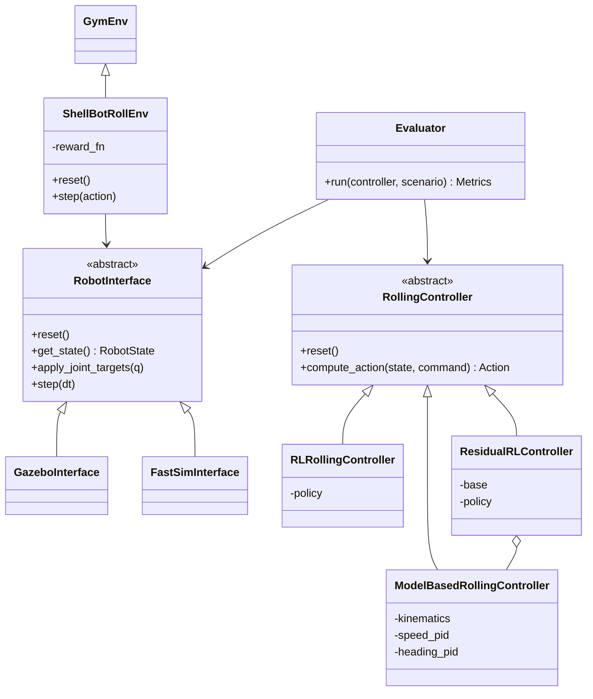

# 期末專題提案：六足變形機器人之球型滾動運動控制

> **學號：** 112700033
> **課程：** Advanced Object-Oriented Programming (AOOP), 2026 Fall
> **日期：** 2026-10-26

---

## 1. 摘要

本專題的目標是讓一台「六足 ↔ 球型」變形機器人在**球型模式下完成滾動運動**，使機器人在閉合成球體後，能依速度指令直線滾動與轉向。核心部分採用 **model-based** 方法：從剛體滾動模型推導控制律，再透過既有的運動學 (FK / IK / CLIK) 轉成關節指令。

若時間允許，延伸目標是為同一個任務建立 **強化學習 (RL) 訓練環境**，訓練 learning-based 控制器，並在相同場景與指標下**比較 model-based 與 learning-based 兩種方法**的表現、強健性與開發成本。

整體軟體以物件導向方式設計：兩種控制器實作同一個抽象介面，模擬器也透過 adapter 隔離，讓比較實驗在公平、可重現的條件下進行。

---

## 2. 背景與動機

### 2.1 機器人平台

本專題使用的機器人參考 MorpHex 的設計，由上下兩個半部組成：

| 部位 | 構造 | 自由度 |
|------|------|--------|
| 下半部 | 6 隻空間 4R 腿，第一軸 (folding fan) 由齒輪連動、6 腿共用 | 4-DOF / 腿 |
| 上半部 | 6 組平面 RR 機構，末端直接連接上半球殼 | 2-DOF / 組 |
| 合計 | 模擬模型共 36 個關節 | — |

六足模式下由下半部 6 腿步行；變形後上下殼片閉合成一顆球。

**開發平台：** ROS Noetic、Gazebo 11、Python 3.8；機器人以 URDF/Xacro 描述，運動學以 D-H 參數推導，並以 CLIK (Closed-Loop Inverse Kinematics) 求解關節角。

### 2.2 為什麼要做球型運動

- **效率：** 在平坦或下坡路面，滾動的移動速度與能源效率通常優於六足步行。
- **保護性：** 球型時腿部與內部元件收在殼內，較不易受損。
- **互補性：** 六足模式負責不平整地形，球型模式負責平坦地面的快速移動；兩種模式都能運作，變形機器人才有意義。

### 2.3 為什麼適合比較 model-based 與 learning-based

球型滾動有幾個難以精確建模的特性：

- **非完整約束 (nonholonomic)：** 純滾動限制了瞬時可達的運動方向。
- **接觸頻繁切換：** 球殼由多片殼片組成，接地的殼片會隨滾動相位改變。
- **質心與構型耦合：** 腿 / 殼片的每個動作都會同時改變質心位置與接觸幾何。

這讓「手推模型 + 控制律」和「讓 agent 從互動中學習」兩條路線各有明顯的優缺點，是一個很適合拿來做對照實驗的題目。

---

## 3. 專題目標

### 3.1 核心目標 (Must-have)

1. **球型滾動機制分析：** 在閉合構型下，分析可行的推進方式 (見 4.1)，並計算各構型的質心位置。
2. **直線滾動：** 機器人可依 `cmd_vel` 指令沿指定方向穩定滾動，速度可調。
3. **轉向與航向控制：** 可改變滾動方向，並以回授修正航向偏差。
4. **模式整合：** 滾動控制可與既有的六足 ↔ 球型變形流程無縫切換 (變形 → 滾動 → 停止 → 展開)。
5. **測試與文件：** 核心數學模組 (質心計算、滾動相位估測、控制律) 有 `pytest` 單元測試。

### 3.2 延伸目標 (Stretch goal，時間允許時進行)

1. 建立 Gymnasium 介面的 RL 訓練環境。
2. 以 PPO (必要時加上 SAC) 訓練滾動控制策略。
3. 在相同場景下系統性比較 model-based 與 learning-based 控制器。

---

## 4. 研究方法

### 4.1 球型滾動的推進機制

先評估兩種候選機制，再依模擬結果選定或組合使用：

**(a) 質心偏移 (CoM shifting)**
在殼片保持閉合的前提下，調整內部腿部構型，讓質心偏離球心。設球半徑 $R$、總質量 $m$、質心相對球心的水平偏移量 $d$，則重力對接觸點產生的滾動力矩為：

$$\tau_g = m\,g\,d$$

在純滾動假設 ($v = R\,\omega$) 下，可近似得到角加速度 $\alpha \approx \tau_g / (I_G + mR^2)$。在傾角 $\beta$ 的斜坡上，要維持靜止或向上滾動，需滿足 $d \ge R\sin\beta$，因此可爬坡角度上限為：

$$\beta_{max} = \arcsin\!\left(\frac{d_{max}}{R}\right)$$

這個式子可以直接用來評估質心偏移機制的能力上限。

**(b) 殼片撥地 (shell-segment push-off)**
依目前的滾動相位，讓接近地面、位於滾動方向後方的殼片短暫向外推出，直接對地面施力推動球體，類似「划槳」。推力較大，但每次推出都會暫時破壞球形外觀與滾動的連續性。

### 4.2 Model-based 控制器 (核心)

控制架構分為三層：

```
cmd_vel (v_des, heading_des)
        │
        ▼
┌─────────────────────────────┐
│ 速度 / 航向迴路 (PID)        │  ← 球體角速度、姿態 (IMU / 模擬真值)
│  輸出：期望質心偏移 d、方向 │
└──────────────┬──────────────┘
               ▼
┌─────────────────────────────┐
│ 滾動步態規劃                 │  ← 滾動相位估測 (哪幾片殼片接地)
│  輸出：各腿 / 殼片目標位置   │
└──────────────┬──────────────┘
               ▼
┌─────────────────────────────┐
│ 運動學層 (FK / Jacobian /    │
│ CLIK)                        │
│  輸出：36 個關節目標角       │
└─────────────────────────────┘
```

1. **質心模型：** 利用 FK 與 URDF 中的各連桿質量 / 慣量，計算任意構型下的整體質心；建立「構型 → 質心偏移」的對應表或解析式。
2. **滾動相位估測：** 由球體姿態 (quaternion) 判斷目前哪幾片殼片接地、哪一片即將接地。
3. **滾動步態：** 依相位週期性地切換負責偏移質心 / 撥地的腿，讓推進力在滾動過程中保持連續。
4. **回授控制：** 外迴路以 PID 追蹤目標速度 (調整 $d$ 的大小) 與目標航向 (調整偏移方向)。

### 4.3 Learning-based 控制器 (延伸)

| 項目 | 設計 |
|------|------|
| **環境** | Gymnasium `Env`，底層透過 `RobotInterface` 驅動模擬器 |
| **Observation** | 關節角 / 角速度、球體姿態 (quaternion)、角速度、線速度、目標速度與航向、上一步 action |
| **Action** | 分階段設計：① 低維參數 (質心偏移量、撥地時機) → ② 在 model-based 輸出上加殘差 (residual RL) → ③ 直接輸出關節目標角 |
| **Reward** | $r = w_1 e^{-\lVert v - v_{cmd}\rVert^2} - w_2\lvert\psi - \psi_{cmd}\rvert - w_3\sum\lvert\tau_i\dot q_i\rvert - w_4\lVert a_t - a_{t-1}\rVert^2 - r_{fail}$ |
| **終止條件** | 殼片異常張開、卡住不動超過時限、偏離路徑過遠 |
| **演算法** | PPO (`stable-baselines3`)；若樣本效率不足再嘗試 SAC |
| **強健性** | Domain randomization：摩擦係數、質量分布、地面坡度、致動器延遲 |
| **Curriculum** | 平地低速直線 → 變速 → 轉向 → 斜坡 |

**模擬器選擇：** Gazebo 單一實例的模擬速度不足以支撐 RL 所需的大量樣本。計畫以 headless 模式加多實例平行化為優先；若仍不足，評估將同一份 URDF 匯入 PyBullet、MuJoCo 或 Isaac Sim 進行訓練。為了確保比較公平，**最終評估時兩種控制器會在同一個模擬器、同一組場景下執行**。

### 4.4 物件導向軟體架構 (與 AOOP 課程的連結)

為了讓兩種控制器可以在完全相同的條件下比較，並且不綁定特定模擬器，軟體架構設計如下：



| 設計 | 用途 |
|------|------|
| **抽象基底類別** `RollingController` | 所有控制器都實作 `compute_action()`，`Evaluator` 不需要知道控制器內部是 PID 還是神經網路 (Strategy pattern) |
| **Adapter** `RobotInterface` | 把 ROS/Gazebo 或其他模擬器的 API 包裝成統一介面，控制器與環境程式碼不需要因為換模擬器而改寫 |
| **Composition** `ResidualRLController` | 持有一個 model-based 控制器，再疊加 RL 殘差，重用既有邏輯而不是複製 |
| **設定與程式分離** | 機器人參數、reward 權重、實驗場景放在 YAML，實驗可重現 |
| **pytest 單元測試** | 驗證 FK/IK 一致性、質心計算、滾動相位判斷、reward 函式 |

預計的目錄結構：

```
final_project/
├── proposal.md
├── src/
│   ├── interfaces/      # RobotInterface 與各模擬器 adapter
│   ├── controllers/     # model-based / RL / residual 控制器
│   ├── envs/            # Gymnasium 環境與 reward
│   └── evaluation/      # 比較實驗與指標計算
├── configs/             # 機器人參數、reward 權重、實驗場景 (YAML)
├── tests/               # pytest
└── results/             # 實驗數據、圖表、影片
```

---

## 5. 實驗設計：Model-based vs. Learning-based

### 5.1 測試場景

| # | 場景 | 目的 |
|---|------|------|
| S1 | 平地直線，目標速度 0.05 / 0.10 / 0.20 m/s | 基本速度追蹤能力 |
| S2 | 平地轉向 (定點改變航向、繞圓) | 航向控制與機動性 |
| S3 | 斜坡 5° / 10° 上坡與下坡 | 爬坡極限、下坡時的速度控制 |
| S4 | 摩擦係數 ±50% | 對模型誤差的強健性 |
| S5 | 滾動中施加外力擾動 | 擾動恢復能力 |

### 5.2 量化指標

| 指標 | 定義 |
|------|------|
| 速度追蹤誤差 | 實際速度與目標速度的 RMSE |
| 航向 / 路徑誤差 | 航向角 RMSE、終點與目標點的距離 |
| 能源效率 | Cost of Transport：$\mathrm{CoT} = \dfrac{\sum\lvert\tau_i\dot q_i\rvert}{m\,g\,v}$ |
| 成功率 | 在時限內抵達目標、且殼片未異常張開的比例 |
| 強健性 | S4 / S5 相對於 S1 的性能下降幅度 |
| 開發成本 | 開發工時、需手動調整的參數數量 |
| 訓練成本 (RL) | 訓練樣本數、wall-clock 訓練時間 |

### 5.3 質性比較面向

| 面向 | Model-based | Learning-based |
|------|-------------|----------------|
| 可解釋性 | 高，行為可由模型推導 | 低，策略為黑盒 |
| 對模型精確度的依賴 | 高 | 較低，可透過 domain randomization 補償 |
| 開發方式 | 推導、手動調參 | 設計 reward、調超參數、等待訓練 |
| 新任務的擴充性 | 每個新任務需重新設計 | 修改 reward / 場景後重新訓練 |
| Sim-to-real 風險 | 較低 | 較高 |

實驗的重點是用數據驗證或推翻上表中的預期，並觀察 RL 是否能發現 model-based 設計中沒有想到的滾動策略。

---

## 6. 時程規劃

| 階段 | 時間 | 工作內容 | 產出 |
|------|------|----------|------|
| Phase 0 | 第 9 週 | 整理開發環境；確認閉合構型；完成質心計算模組與測試 | 質心模組、pytest |
| Phase 1 | 第 10–11 週 | 推導滾動模型；評估兩種推進機制；完成平地直線滾動 | 直線滾動 demo |
| Phase 2 | 第 12 週 | 速度 / 航向回授、轉向、與變形流程整合 | **核心目標完成** |
| Phase 3 | 第 13–14 週 | *(延伸)* Gymnasium 環境、PPO 訓練、curriculum | 訓練好的策略 |
| Phase 4 | 第 15 週 | 比較實驗 (S1–S5)、數據分析 | 比較結果與圖表 |
| Phase 5 | 第 16 週 | 撰寫期末報告、製作簡報與 Demo 影片 | 期末報告、Demo 影片 |

> 若第 12 週結束時核心目標尚未完成，延伸目標會縮減為「只在 S1 平地直線場景做 RL 訓練與比較」，確保第 15 週仍有一組完整的對照結果。

---

## 7. 預期成果

1. 球型模式下可依指令直線滾動與轉向的 model-based 控制器。
2. 滾動機制分析：質心偏移與殼片撥地的比較，以及爬坡角度上限的理論值與模擬驗證。
3. 物件導向、模擬器無關的控制與評估框架，附單元測試。
4. *(延伸)* RL 訓練環境與訓練好的滾動策略。
5. *(延伸)* Model-based 與 learning-based 方法的量化比較報告。
6. Demo 影片與期末簡報。

---

## 8. 風險與備案

| 風險 | 影響 | 備案 |
|------|------|------|
| 殼片 mesh 碰撞在 Gazebo 中不穩定 (抖動、穿透) | 滾動行為失真 | 以簡化的球形碰撞體取代複雜 mesh；調整 contact 參數 |
| 閉合構型下可產生的質心偏移太小 | 推力不足、無法滾動或爬坡 | 改以殼片撥地為主要推進機制，或兩者組合 |
| Gazebo 模擬太慢，無法支撐 RL 訓練 | 延伸目標延誤 | headless + 多實例；改用較快的模擬器訓練；降低 action 維度 |
| RL 不收斂或學到不合理的行為 | 無法比較 | 先做 residual RL；使用 curriculum；檢查 reward shaping |
| 時間不足 | 延伸目標無法完成 | 依第 6 節的備案縮減比較範圍，優先保證核心目標 |

---

## 9. 參考資料

1. K. Halvorsen (Zenta), *MorpHex — Morphing Hexapod Robot*, 機構設計參考。
2. "A Morphing Mobile Robot with Six-legged and Spherical Movement Modes," *Proc. IEEE International Conference on Information and Automation (ICIA)*, Wuyi Mountain, China, 2018.
3. *Progetto esapode sferico* (Spherical Hexapod Project), 技術報告, Università di Pisa — 運動學推導參考。
4. B. Siciliano, L. Sciavicco, L. Villani, G. Oriolo, *Robotics: Modelling, Planning and Control*, Springer, 2009 — CLIK 與 Jacobian。
5. R. Chase, A. Pandya, "A Review of Active Mechanical Driving Principles of Spherical Robots," *Robotics*, 2012.
6. J. Schulman et al., "Proximal Policy Optimization Algorithms," arXiv:1707.06347, 2017.
7. T. Haarnoja et al., "Soft Actor-Critic: Off-Policy Maximum Entropy Deep Reinforcement Learning with a Stochastic Actor," *ICML*, 2018.
8. A. Raffin et al., "Stable-Baselines3: Reliable Reinforcement Learning Implementations," *JMLR*, 2021.
9. J. Hwangbo et al., "Learning Agile and Dynamic Motor Skills for Legged Robots," *Science Robotics*, 2019.
